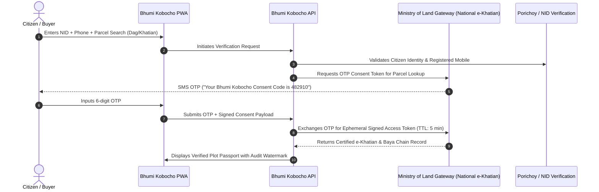

# Bhumi Kobocho (ভূমি কবচ) — Production Integration Roadmap

> [!IMPORTANT]
> **DEMO STATUS & HARD COMPLIANCE BOUNDARY**
> In accordance with hackathon ethical directives, **Bhumi Kobocho operates strictly on synthetic demo data**.
> The application contains **NO scraping routines, NO reverse engineering, and NO unauthorized calls to live government portals or databases**.
> This roadmap documents how an authorized, lawful public-private partnership would transition the platform into production.

---

## 1. Architectural Foundation: The Data Adapter Layer

Bhumi Kobocho is built with a decoupled adapter architecture located in [`backend/app/adapters/`](file:///d:/Professional/hackathon/landtech/BhumiKoboch/backend/app/adapters/). The core rule engine, Plot Passport generator, and Land Guardian monitor interact solely with the abstract [`LandRecordSource`](file:///d:/Professional/hackathon/landtech/BhumiKoboch/backend/app/adapters/base.py) interface:

```python
class LandRecordSource(ABC):
    @abstractmethod
    def get_parcel(self, parcel_id: str) -> Optional[Dict[str, Any]]: ...
    
    @abstractmethod
    def search(self, dag_no=None, khatian_no=None, mouza=None, deed_no=None) -> List[Dict[str, Any]]: ...
    
    @abstractmethod
    def get_history(self, parcel_id: str) -> List[Dict[str, Any]]: ...
    
    @abstractmethod
    def get_cases(self, parcel_id: str) -> List[Dict[str, Any]]: ...
```

In the current demonstration environment, [`SyntheticSource`](file:///d:/Professional/hackathon/landtech/BhumiKoboch/backend/app/adapters/synthetic.py) implements this interface backed by our indexed SQLite database of 20,000 synthetic transactions.

In an authorized production rollout, an `AuthorizedGovtSource` implementation will replace `SyntheticSource` without altering a single line of client UI code or business rule logic.

---

## 2. Institutional & Legal Framework

Direct electronic integration with national land registries cannot occur through informal interfaces. It requires a formal tripartite agreement:

1. **Memorandum of Understanding (MoU)**: Executed between the Ministry of Land (ভূমি মন্ত্রণালয়), the Directorate of Registration (আইন ও বিচার বিভাগ), and the operating entity.
2. **Formal Data Sharing Agreement (DSA)**:
   - Specific definitions of permitted query attributes (Mouza, JL, Dag, Khatian).
   - Strict prohibition against mass data extraction, index caching, or commercial resale.
   - Purpose limitation: verification and citizen advisory services only.
3. **Statutory Compliance**:
   - Compliance with the **Cyber Security Act 2023** and draft **Data Protection Act (DPA)**.
   - Recognition of citizen digital consent standards under the Evidence Act amendments.

---

## 3. Citizen Consent Architecture (Two-Factor Authorization)

No citizen's land ownership record or mutation history may be retrieved without verified citizen authorization. The production integration must implement an explicit consent workflow:



### Consent Safeguards:
- **Zero Third-Party Queries**: Inquiries require the authenticated presence of either the registered landowner or an authorized prospective buyer with an active deed verification intent.
- **One-Time Access Tokens**: Tokens expire within 5 minutes and are non-transferable across IP addresses.

---

## 4. Technical Integration & Security Protocols

### A. Mutual TLS (mTLS) & Hardware Security Modules (HSM)
- All traffic between Bhumi Kobocho and the Ministry of Land's integration gateway traverses dedicated point-to-point IPsec VPN tunnels with mutual TLS (TLS 1.3).
- API client certificates and private signing keys reside inside FIPS 140-2 Level 3 Hardware Security Modules.

### B. Immutable Cryptographic Audit Logging
Every parcel inquiry generates a cryptographically signed audit log stored in a tamper-evident append-only ledger:
- **Timestamp (UTC)**
- **Citizen NID Pseudonymized Digest** (SHA-256 HMAC)
- **Parcel Identifier Queried** (`PCL-...`)
- **Query Purpose / Context** (Buyer Pre-Check, Owner Self-Audit, Succession Review)
- **Consent Token ID**

These logs are mirrored in real time to the Ministry's central oversight dashboard, guaranteeing total transparency and preventing unauthorized administrative surveillance.

---

## 5. Phased Rollout Roadmap

| Phase | Milestone | Scope & Deliverables | Governance & Approvals |
| :--- | :--- | :--- | :--- |
| **Phase A (Current)** | **Civic Hackathon Prototype** | 100% synthetic dataset, SQLite backend, deterministic rule engine, offline PWA, zero live calls. | Internal Hackathon Evaluation |
| **Phase B (Sandbox)** | **Official Sandbox Pilot** | Implement `GovtSandboxSource` adapter using mock REST endpoints provided by Ministry of Land's ICT division. | Ministry ICT Cell Approval |
| **Phase C (Single Upazila)**| **Controlled Field Pilot** | Deploy in 1 selected pilot Upazila (e.g. Savar or Singra) for live e-Khatian queries under monitored citizen consent. | Cabinet / Ministerial Sanction |
| **Phase D (National)** | **Nationwide Citizen Portal** | Full national integration with e-Mutation, e-Porcha, and Sub-Registry Balom records. | Public Digital Service Gazette |

---

## 6. Summary

Bhumi Kobocho's architecture is intentionally production-ready at the software boundary. By cleanly encapsulating data access within the `LandRecordSource` adapter, the platform provides maximum citizen utility today using safe synthetic simulation, while maintaining an uncompromised path to authorized national infrastructure.
